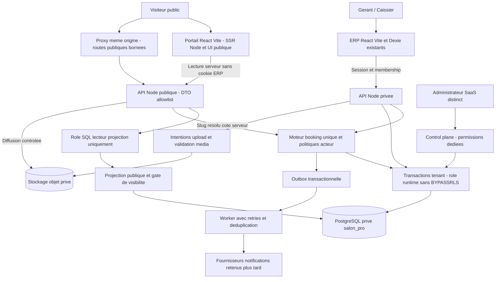
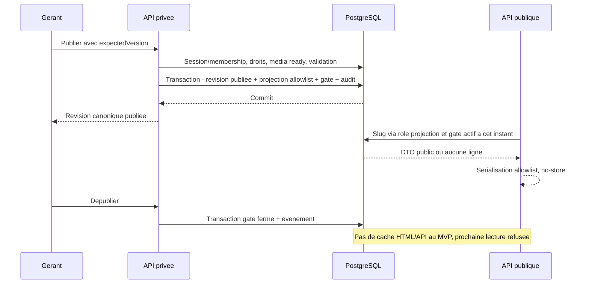
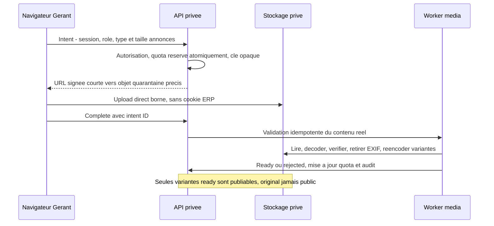
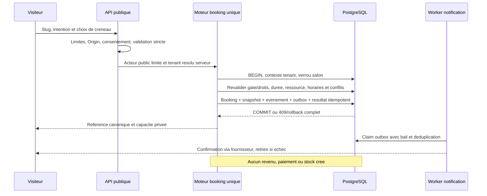

# PROMPT 01 — Architecture cible Marketplace & Booking

Date : 1er novembre 2026. Référence : `e191a1d9235471bc937c6a2ca21a4060020d721f`, branche `arena/1bd00d86-barbershop`.

**Statut : proposition d’architecture pour validation, non implémentée.** L’autorisation de commencer porte ici sur le PROMPT 01, pas sur un déploiement ou le PROMPT 02. Ce document et les six ADR complètent l’[audit 00](00_REPOSITORY_AUDIT.md) ; ils ne changent aucun schéma, route ou flag. La [baseline 00](00_BASELINE_RESULTS.md) distingue les preuves locales de la recette hébergée, toujours manquante.

## 1. Décisions proposées et porte de sortie

| Sujet | Proposition | ADR |
|---|---|---|
| Portail | Application React/Vite indépendante dans `marketplace/`, rendu serveur Node pour le public ; ERP Vite inchangé | [001](adr/ADR-001_PUBLIC_PORTAL.md) |
| Lecture publique | Projection explicite, gate de visibilité et rôle SQL de lecture restreint ; jamais de lecture anonyme du métier | [002](adr/ADR-002_PUBLIC_READ_MODEL.md) |
| Média | Objets privés, upload signé en quarantaine, variantes validées ; diffusion contrôlée | [003](adr/ADR-003_MEDIA_STORAGE.md) |
| RDV | Faire évoluer **`bookings` 008**, un moteur unique ; verrou actuel + contrainte SQL d’exclusion avant booking public | [004](adr/ADR-004_BOOKING_CONCURRENCY.md) |
| SaaS | Autorité serveur unique, droits par données et événements audités ; paiement et boost séparés des ventes salon | [005](adr/ADR-005_ENTITLEMENTS.md) |
| Origines | ERP et portail séparés ; proxy public à routes bornées, même origine vue du navigateur ; aucun cookie ERP partagé | [006](adr/ADR-006_DOMAINS_COOKIES.md) |

Les domaines, fournisseur média/paiement/notifications, tarifs, quotas et règles de réservation restent à arbitrer. **Le maintien de React/Vite, sans Next.js, est une décision utilisateur explicite.** La séparation des applications, le détail du SSR et les autres choix restent proposés, pas réputés approuvés par cette seule décision. La porte avant code est une validation de ces six sujets et des inconnues bloquantes du lot concerné.

## 2. Portail React/Vite : décision utilisateur et comparaison

**Révision suite à la décision utilisateur : conserver Vite pour homogénéiser la stack. Next.js n’est pas retenu.** La comparaison initiale exigée par le playbook reste documentée ci-dessous ; sa recommandation Next.js est remplacée par cette décision explicite.

| Critère | A — Next.js séparé, écarté | B — Public dans la SPA Vite ERP | C — React/Vite public séparé avec SSR Node, proposé |
|---|---|---|---|
| Homogénéité | Nouveau framework et conventions | Même outillage, même application | Même React/TypeScript/Vite/API Node ; aucun nouveau framework imposé |
| SEO | Rendu serveur et métadonnées intégrés | HTML initial du shell ERP insuffisant sans SSR/prérendu additionnel | HTML, titres/OG/canonical/JSON-LD rendus serveur par URL ; travail explicite à réaliser |
| Déploiement | Deux projets et conventions Next | Build commun, changement des routes/rewrite/SW | Deux builds applicatifs ; bundle SSR Node et assets client du portail |
| Cookies/CORS | Isolation avec façade publique | Même origine, mais risque de mélange privé/public | Même séparation logique et proxy public borné, sans cookies ERP partagés |
| Coûts | SSR, proxy, second framework à maintenir | Infrastructure initiale moindre, refonte SSR/PWA risquée | SSR/proxy et adaptation de déploiement à maintenir ; pas de coût fournisseur présumé |
| Maintenance | Écosystème supplémentaire | Couplage fort des releases et dépendances | Conventions Vite communes ; responsabilité explicite du routage SSR et de l’hydratation |
| Risque ERP | Faible si bien isolé | Régression route racine, contextes auth et SW scope `/` | Isolation des routes/builds/SW, ERP inchangé |

**Cible proposée : option C**, pas une migration de l’ERP vers SSR. Rester sur Vite ne signifie pas qu’une SPA seule satisfait automatiquement l’indexation et les aperçus sociaux. Un portail statique prérendu reste possible pour les pages commerciales fixes, mais pas comme seul mécanisme pour les fiches dynamiques dont la dépublication doit prendre effet immédiatement.

### Introduction du portail Vite sans casser l’ERP

**Phase 04 seulement**, après contrats validés : sous-projet `marketplace/` avec `package.json`, lockfile, `tsconfig.json`, `vite.config.ts`, template HTML, `src/entry-client.tsx`, `src/entry-server.tsx`, routes/composants publics, adaptateur HTTP Node et tests. Aligner les versions React/Vite/TypeScript avec les versions root supportées, sans upgrade forcé ni Next.js. Aucun de ces fichiers n’est créé maintenant.

- Racine : `npm ci`, `npm test`, `npm run build` gardent le périmètre ERP/API et la sortie `dist`. Pas de conversion immédiate du root en workspace.
- Portail : deux sorties propres, par exemple `marketplace/dist/client` et `marketplace/dist/server`. Build client Vite + build SSR Vite avec manifeste des assets ; le serveur ne diffuse jamais le bundle SSR comme fichier public.
- Rendu : routeur React public indépendant, requête des DTO publics côté serveur, rendu React serveur puis hydratation cliente avec les mêmes données publiques sérialisées de façon sûre. HTTP 404 réel pour fiche invisible ; pas de fallback 200 vers le shell ERP. Aucune PII ni capacité secrète dans l’état SSR, les métadonnées ou les erreurs.
- Titres, description, OG, canonical, robots et JSON-LD doivent être présents dans le HTML initial **sans exécution JavaScript**, échappés selon leur contexte. Le code serveur reste request-scoped, sans état utilisateur global ni données injectées non échappées.
- En dev, Vite middleware SSR dans le serveur Node ; en production, import du bundle SSR compilé et assets client avec chemins validés. **`vite preview` n’est pas le serveur SSR de production.**
- Déploiement : projet portail distinct et adaptateur Node/serverless explicite, à tester avant choix définitif de l’hébergement. Un preset « Vite statique » avec sortie `dist` ne suffit pas au SSR ; définir fonction de rendu, routage, manifestes et headers propres. Ne pas recopier le `vercel.json` ERP. Aucun build n’applique de migration.
- Proxy `/api/public/*` borné dans l’adaptateur Node ou la couche de déploiement, pas seulement `server.proxy` Vite (réservé au dev). SSR → backend par URL serveur configurée ; navigateur → URLs relatives. Voir ADR-006.
- CI : garder les jobs ERP/schema et ajouter lint/tests/build client+SSR et tests HTTP de contrat/HTML du portail. Pas de supposition que le lint root couvre tout le sous-projet.
- Aucun import des contextes privés, Dexie, `pg`, secrets ou modèles complets ERP dans le client public. Extraction future de types/validateurs/tokens visuels purs seulement après vérification des deux builds.
- Aucun déplacement de `/cash`, `/booking`, auth ou route racine ERP. Pas de SW portail au MVP. L’homogénéité des outils n’impose ni partage des sessions ni couplage des données.

## 3. Composants et frontières de confiance

Un backend logique commun, pas nécessairement un processus permanent : l’entrée `api/[...route].ts` et le plugin Vite restent les adaptateurs. Worker média/notifications séparé des durées de requête serverless. Aucun DDL sur requête publique ; migrations explicites et versionnées. Accès SQL serveur seulement ; aucun client Supabase direct sur le métier privé. Les anciennes tables globales d’authentification ne deviennent jamais un annuaire public.

## 4. Domaines et responsabilités

| Domaine | Autorité et données cibles | Interdictions / dépendances |
|---|---|---|
| Directory | Recherche paginée, filtres validés, catégories/localisations et slugs publiés | Pas de scan des payloads financiers ni profil brouillon |
| Profile / media | Brouillon, version publiée, services publics, coordonnées consenties, modération, galerie ordonnée | Publication explicite ; pas de copie automatique de `SalonInfo` ou téléphone employé |
| Scheduling | Fuseau IANA `tenants.timezone`, horaires locaux récurrents, exceptions datées, ressources, blocages | Le navigateur n’est plus autorité du fuseau ; refus si réglages nécessaires absents |
| Appointments | Évolution de `bookings`, lignes de services/snapshots, statuts/version/audit et origine | Une source de vérité, aucun paiement/stock automatique |
| Subscriptions / entitlements | Plans configurés, souscriptions, événements, calcul de droits et quotas | Aucune activation sur retour navigateur ; aucune suppression des données après résiliation |
| Promotions | Campagnes ponctuelles, période, emplacements, paiement/approbation et label sponsorisé | Pas un deuxième abonnement ni un droit implicite au classement trompeur |
| Analytics | Événements minimisés, agrégats salon, consentement/rétention | Pas de contacts, notes client, tokens, salaire ou recette dans événements publics |
| Notifications | Outbox, modèles, destinataire privé, retries, preuve de remise/échec | Pas d’envoi dans la transaction DB ; pas de promesse exactement-une-fois externe |
| Control plane | Provisioning salon, modération et souscriptions audités avec rôle plateforme distinct | Pas de super-rôle implicite pour un Gérant ; pas de lecture caisse/paie par défaut |

### Scheduling et disponibilité

Les horaires sont exprimés en heure locale du salon, les occurrences stockées/échangées en instants UTC `timestamptz`. Exceptions et blocs l’emportent sur les horaires récurrents. Validation des durées de variantes, buffers, pas, horizon et délai minimum côté serveur ; valeurs issues de réglages validés, sans defaults commerciaux inventés. Tester explicitement heure ambiguë/inexistante et changement de jour ; `Africa/Abidjan` ne dispense pas des autres IANA.

La disponibilité publique est indicative et ne contient jamais la liste privée des réservations. Ne pas la dériver de la liste ERP tronquée à 200. Le moteur requête les occupations complètes pour l’intervalle demandé avec bornes et coût limités. Le POST recalcule tout sous verrou ; un slot affiché n’est pas une garantie et ne constitue pas une pré-réservation.

## 5. Contrats API/DTO cibles

Contrats proposés **non disponibles aujourd’hui**. Montants entiers XOF, instants ISO UTC, dates locales `YYYY-MM-DD` accompagnées du fuseau salon. API publique versionnée par contrat initial v1 ; les évolutions incompatibles nécessitent une version explicite. Pas de sérialisation par spread d’un modèle interne.

| DTO / commande | Champs autorisés et règles | Données exclues |
|---|---|---|
| `PublicSalonSummaryV1` | `slug`, `displayName`, catégorie, localisation publique consentie, couverture validée, prix indicatif XOF si configuré, `bookingEnabled`, label sponsorisé éventuel | tenant/org/user IDs, données privées, abonnement détaillé |
| `PublicSalonProfileV1` | Résumé + description texte validée, contacts publics consentis, galerie et crédits, horaires/fuseau, services publics, révision publiée | managerName privé, emails de comptes, paie, paramètres internes, `payload_json` |
| `PublicServiceV1` | Identifiant public opaque, libellé/description, variante publique, prix XOF, durée réservable | coût, commission, consommation stock et IDs privés catalogue |
| `PublicAvailabilityV1` | service/variante publique, fuseau, instants début/fin et sélection ressource publique si autorisée | noms/contacts/notes des autres clients, IDs employés privés ; préférer ressource opaque |
| `CreatePublicBookingV1` | clé d’idempotence, service(s)/variante autorisés, ressource publique facultative, début choisi, nom/contact nécessaire et preuve de consentement versionnée | `tenantId`, `createdBy`, prix, durée, fin et statut imposés par navigateur |
| `PublicBookingReceiptV1` | Référence opaque, statut canonique, horaire/service/salon ; accès ultérieur par capacité vérifiée | email/téléphone/notes en accès par simple référence ; aucune identité ERP |
| Commande privée profil/média/agenda | Session vivante, tenant dérivé, rôle, version attendue ; projection propre au rôle | tenant du corps comme autorité ; octets média dans sync/backups Dexie |
| `EffectiveEntitlementsV1` | Capacités et quotas utiles au compte, calcul serveur, validité/révision | secrets paiement ; calcul de droits autoritaire côté client |

Le contrat public de réservation ne reprend pas les 5–480 minutes libres de l’API interne. Commencer avec une seule prestation/variante réservable au MVP ; concevoir les lignes de snapshots pour pouvoir étendre ensuite, sans exposer dès maintenant une combinaison multi-services non validée.

### Routes et compatibilité

- Lecture : `GET /api/public/salons`, `/:slug`, `/:slug/services`, `/:slug/availability`, catégories/localisations ; pagination stable et bornée, erreurs neutres.
- Écriture publique : `POST /api/public/salons/:slug/bookings` ; consultation/annulation par référence **et capacité secrète limitée**, jamais par référence seule.
- Privé profil/média : familles `/api/salon/public-profile`, `/api/salon/media/*`, `/api/salon/public-services`, publish/unpublish. Pas de remplacement du formulaire salon privé.
- Privé agenda : conserver `/api/booking/list|create|update` comme adaptateurs compatibles du moteur unique. Les routes `/api/appointments*` suggérées par le playbook ne sont pas une deuxième implémentation : ajout seulement si utile, avec adaptateur/versionnement et période de compatibilité.
- SaaS : `/api/saas/*` pour le Gérant, namespace d’administration plateforme séparé, webhooks fournisseur dédiés. Les routes privées ne passent jamais par le proxy public.
- HTTP : 404 indistinguable pour slug absent/brouillon/suspendu, 409 conflit de créneau/version/intention, 422 saisie, 429 limitation avec Retry-After, 503 module indisponible. Aucun message SQL/PII au navigateur.

## 6. Résolution cross-tenant et publication

Voir ADR-002 pour la politique SQL proposée. Le rôle de lecture n’a accès qu’aux projections et au gate public, jamais aux revenus/employés/utilisateurs. Le slug global normalisé est une clé publique **non autorisante**. Le tenant est résolu uniquement côté serveur, puis une transaction tenant revalide publication, activité et droits avant toute écriture.

Modification d’un brouillon ≠ modification silencieuse de la version publiée. Tenant suspendu pour sécurité, dépublication et expiration de droits ferment le gate. Les mises à jour qui ferment l’accès doivent être atomiques avec leurs sources ; les échéances sont également évaluées au temps DB, sans dépendre d’un cron. Pas de suspension « facturation » convertie en `tenants.status=suspended`, qui bloquerait aujourd’hui l’ERP entier.

**Cache MVP :** SSR et fetch publics dynamiques `no-store`, pas de cache de pages générées ni de CDN HTML/API ; aucune donnée privée dans le cache du processus SSR. `robots`/canonical/noindex et OG sont générés par le serveur à partir des seules données publiées. Le sitemap n’est pas une autorité : même un lien périmé doit conduire à une fiche inaccessible. Analytics ne réintroduit pas les champs exclus.

## 7. Flux média

Le navigateur ne choisit ni tenant ni chemin objet. Le complete ne rend pas un fichier immédiatement public. Nettoyage des intentions expirées et objets orphelins par worker. Au MVP diffusion des variantes via endpoint média public borné vérifiant le gate à chaque demande, depuis stockage privé, `no-store` ; pas d’URL bucket permanente ni de service d’optimisation image qui recacherait la réponse. Coût d’egress/proxy à mesurer. Un document déjà téléchargé ne peut pas être rappelé ; la suppression de nos références et objets n’efface pas les copies externes.

## 8. Flux réservation et conversion caisse

Pas de compte `salon_users` artificiel pour une réservation anonyme. La contrainte actuelle `created_by/actor_id NOT NULL` doit évoluer **additivement**, avec origine/acteur discriminés, en conservant les anciens auteurs ; voir ADR-004. Le reçu ne promet pas qu’une notification a été remise.

Conversion : un utilisateur ERP autorisé sélectionne un RDV éligible ; le serveur fournit une référence de préremplissage, pas une vente. La commande checkout existante recalcule prix, paiements, stock/caisse. Son commit et le lien unique tenant-scoped booking→ticket doivent être atomiques et idempotents ; deux tentatives réutilisent le même résultat. Avant disponibilité de cette garantie, pas de bouton présenté comme « conversion fiable ». Terminer un RDV ne déclenche jamais checkout. Un rollback de transaction ne laisse ni ticket seul ni réservation marquée convertie seule.

## 9. Matrice de permissions cible

| Action | Visiteur / capacité client | Caissier | Gérant | Administrateur SaaS |
|---|---|---|---|---|
| Lire fiche/services publiés | Oui, DTO public | Oui | Oui | Même lecture publique |
| Créer RDV public | Selon gate, droits et anti-abus | Même parcours public, sinon privé lecture seule | Oui via API privée | Pas de droit métier implicite |
| Voir agenda privé / contact client | Non ; uniquement son RDV avec capacité vérifiée | Oui dans son tenant actif, selon contrat agenda actuel | Oui dans son tenant actif | Non par défaut |
| Créer/déplacer/statut RDV privé | Non ; annuler son RDV selon politique avec capacité | Non au MVP, droits actuels conservés | Oui, validation/version | Non par défaut |
| Publier, médias, horaires, catalogue public | Non | Non | Oui + entitlement ; dépublier/supprimer reste accessible après fin de droit | Modération/retrait audité, pas édition métier implicite |
| Convertir en vente | Non | Selon autorisation checkout explicite à valider en 06 | Oui selon caisse et checks serveur | Non |
| Administrer abonnement du salon | Non | Non | Lecture/demande/changement autorisé de son tenant | Provisioning/activation manuelle/modération audités |
| Voir caisse/paie/autres tenants | Non | Selon droits ERP existants seulement | Seulement tenants autorisés | Non sans procédure de support distincte et auditée |

L’administrateur SaaS est une identité/permission plateforme explicite, pas une valeur injectée dans le rôle métier Gérant/Caissier. Pas de route admin tant que l’authentification forte, la révocation et le journal d’audit ne sont pas définis/testés. Perdre un abonnement ne supprime pas les données ni la possibilité autorisée de traiter les RDV existants ; suspension sécurité et révocation d’un utilisateur restent prioritaires.

## 10. Flags et rollback

Tous les nouveaux flags ci-dessous sont **proposés, serveur et off par défaut**, non ajoutés dans ce lot.

| Flag | Effet off | Dépendances / ce qui doit continuer |
|---|---|---|
| `PUBLIC_MARKETPLACE_ENABLED` | Ferme annuaire/fiches et nouvelles réservations publiques | ERP, agenda interne, traitement des RDV existants indépendants |
| `PUBLIC_PROFILE_PUBLISH_ENABLED` | Refuse nouvelle publication | Dépublication, suppression média, lecture déjà publiée si gate valide restent possibles |
| `PUBLIC_BOOKING_ENABLED` | Refuse nouvelles réservations publiques | Consultation/annulation vérifiées des RDV déjà pris et agenda privé restent possibles |
| `PUBLIC_MEDIA_UPLOAD_ENABLED` | Refuse nouvelle intention upload | Suppression et cleanup possibles ; traitement sûr d’intentions déjà acceptées |
| `PROMOTIONS_ENABLED` | Refuse nouvelles campagnes et placements sponsorisés | Aucune suppression de preuve de paiement ; pas d’impact ERP |
| `SUBSCRIPTION_BILLING_ENABLED` | Refuse nouvelle acquisition de paiement | Conservation/audit/rapprochement d’événements déjà reçus ; aucun succès webhook sans persistance fiable |

Pas de réemploi du flag privé `SALON_BOOKING_ENABLED` comme kill switch public ; `VITE_BOOKING_ENABLED` n’est que de l’UI, jamais une autorisation. Les flags checkout actuels ne changent pas. Les nouvelles créations publiques exigent aussi publication/droits valides et dépendances disponibles. Erreurs explicites, pas de fallback « réservation locale réussie ».

Rollback applicatif : fermer d’abord les créations du module concerné, drainer/mettre en pause ses workers de façon contrôlée, garder les données/audits/capacités de suivi, revenir à un binaire compatible avec la migration additive. **Ne pas revenir aveuglément à l’ancien moteur après création de RDV publics ou multi-lignes** : fixer un plancher de compatibilité (acteur public, snapshots, contraintes) avant activation. Aucun down destructeur automatique, aucun effacement des bookings ou paiements. Rollback du portail indépendant de l’ERP ; si incident confidentialité, fermer le gate de lecture/média aussi, pas seulement les boutons.

## 11. Design d’intégration et UX

- ERP : garder navigation, palette et accès caisse. Ajouter plus tard entrées « Visibilité » et « Agenda » sans remplacer Paramètres salon. Écrans brouillon/publication et statut sync distincts ; publication uniquement après commit serveur confirmé.
- État vide honnête si aucun salon/service/photo ; aucun exemple de commerce dans les données runtime. Pas de faux compteurs/avis/promesses SEO.
- Portail : navigation annuaire/fiches mobile-first, contact et réservation clairs, prix XOF lisibles, description texte sûre. Galerie accessible avec crédits/alt, composants clavier et reduced-motion.
- Booking : étapes service/ressource/slot/contact/confirmation, fuseau visible, conflits explicites ; intention durable contrôlée sans enregistrer PII dans URL ou analytics. Pour suivi, jeton de capacité dans fragment à échanger puis retirer de l’historique avant chargement de contenu tiers ; aucune mesure marketing sur la page de capacité.
- Agenda : conserver lecture Caissier et actions Gérant ; badges de provenance, conflits/version et indisponibilités. Aucun lien opaque public réutilisable à afficher dans une liste de logs.
- Ne pas partager les composants dépendant de l’auth/salonStore avec le portail. Reprendre les tokens visuels via une extraction pure ultérieure si nécessaire, en testant focus, contraste et poids du bundle.

## 12. Validation avant implementation et inconnues

1. Acter la décision utilisateur React/Vite, puis faire valider les détails ADR-001 à 006 : séparation/SSR/déploiement, projection SQL, stockage, reprise 008, droits et origines.
2. Phase 02 locale : vérifier privilèges/extensions PostgreSQL, migration depuis 001–005 **et** depuis 001–008, contraintes/chevauchements historiques et compatibilité purge ; snapshot généré et isolation. Pas de DDL distant.
3. Fournisseurs/buckets/CDN, limites upload/rétention, règles de booking/contact et décisions commerciales restent non fixés. Aucun prix, durée de grâce, quota ou domaine de production n’est inventé.
4. Exiger avant public booking la concurrence PostgreSQL **multi-connexion réelle**, pas seulement PGlite ; tester course public/interne, horaires modifiés, ressource désactivée, annulation et idempotence.
5. Tester confidentialité DTO/HTML/métadonnées, slug enumeration, brouillon, suspension et expiration sans cron, dépublication/médias, capacités et absence de cache privé.
6. Préparer ensuite un environnement recette isolé avec secrets privés, backup/restauration, HTTPS/domaines, sessions réelles, supervision, E2E mobile/multi-poste. `db:check=missing_configuration` de l’audit n’est pas résolu par ces diagrammes.

Les besoins financiers historiques et leurs tombstones restent protégés. Aucune preuve de déploiement ou d’intégration externe n’est ajoutée par ce lot documentaire. Les résultats des contrôles de ce lot seront consignés dans [01_VALIDATION.md](01_VALIDATION.md).

**Conclusion : PROMPT 01 documentaire livré ; porte d’architecture PARTIAL tant que les propositions ne sont pas validées. PROMPT 02 non commencé. No-Go production maintenu.**
